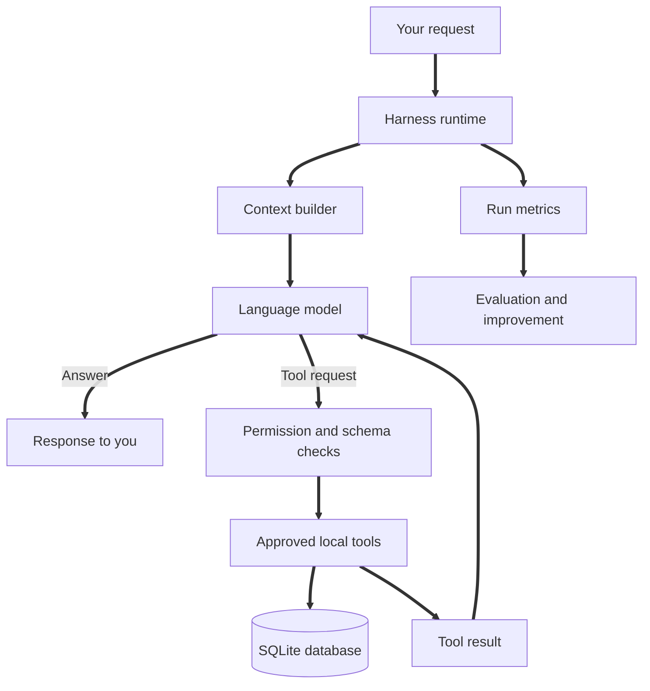

# Everyday AI Harness

A small, local-first AI assistant that demonstrates harness engineering through a practical daily workflow.

The goal is not to build a complicated autonomous agent. The goal is to build a dependable assistant whose behaviour is understandable, limited, testable, and useful every day.

It can:

- Answer everyday questions through an OpenAI-compatible model endpoint.
- Save personal notes when you explicitly ask it to remember something.
- Search saved notes when you ask about previous information.
- Add tasks to a local task list.
- List open, completed, or all tasks.
- Mark a task complete or reopen it when you explicitly ask.
- Keep a short conversation history during the current run.
- Retrieve a few relevant saved notes instead of loading the entire memory store.
- Record operational metrics without logging the contents of your private conversations.
- Stop after a fixed number of model steps and tool calls.

It cannot send emails, delete files, execute shell commands, browse the internet, or make purchases. Those restrictions are deliberate. Start with a small set of low-risk capabilities and add permissions only when a real need appears.

## Two ways to run it

| | Python harness (this README) | Claude Code harness |
|---|---|---|
| Where | repo root | [`claude-code/`](claude-code/README.md) |
| Model loop | `src/everyday_harness/harness.py` | Claude Code |
| Model | Any OpenAI-compatible endpoint | Claude |
| Tools and database | Shared | Shared |

Short reading: [docs/harness-engineering-concise.md](docs/harness-engineering-concise.md). Full essay: [docs/harness-engineering.md](docs/harness-engineering.md).

## 1. The idea in one picture



The model is the reasoning component. The harness is the application around it: instructions, selected context, available tools, orchestration, permissions, persistent state, and feedback.

## 2. Quick start

Full step-by-step instructions for both versions are in [SETUP.md](SETUP.md). The summary below is the Python version.

### Requirements

- Python 3.11 or newer.
- Access to an OpenAI-compatible chat completions endpoint.
- A model name supported by that endpoint.

The example configuration uses a local endpoint. You can replace the endpoint, model name, and API key without changing the harness code.

### Windows PowerShell

```powershell
cd everyday-ai-harness
py -3.11 -m venv .venv
.\.venv\Scripts\Activate.ps1
python -m pip install -e ".[dev]"
Copy-Item .env.example .env
```

If PowerShell blocks virtual environment activation, use this command for the current terminal session:

```powershell
Set-ExecutionPolicy -Scope Process -ExecutionPolicy Bypass
.\.venv\Scripts\Activate.ps1
```

### macOS or Linux

```bash
cd everyday-ai-harness
python3 -m venv .venv
source .venv/bin/activate
python -m pip install -e ".[dev]"
cp .env.example .env
```

### Configure the model

Open `.env` and set the endpoint and model you want to use:

```dotenv
LLM_BASE_URL=http://localhost:11434/v1
LLM_API_KEY=local
LLM_MODEL=YOUR_MODEL_NAME
```

The endpoint above is an example of a local OpenAI-compatible API address. If you use a hosted provider, replace the base URL and API key with the values from that provider. Keep API keys in `.env`. Never commit `.env` to GitHub.

The project uses the OpenAI Python SDK as an HTTP client. The model endpoint remains configurable, so the same application can work with a compatible local or hosted service.

### Start the assistant

```bash
python -m everyday_harness
```

Try these requests:

```text
Remember that I prefer short, structured meeting notes.
Save a note that my weekly review is on Friday afternoon.
Find my saved note about the weekly review.
Add a task titled Review the harness repository.
Show me my open tasks.
```

Type `exit` to close the assistant. Notes and tasks remain in the local SQLite database after the process exits.

## 3. Configure your everyday assistant

You do not need to change Python code to personalise the assistant.

| File | What to change |
|---|---|
| `config/assistant.md` | The assistant's role, behaviour, tool rules, and safety boundaries. |
| `config/profile.md` | Your preferences, working style, and stable personal context. |
| `.env` | Model endpoint, model name, database location, and runtime limits. |

Start with a small profile. Add only information that is useful for repeated tasks. Do not put passwords, API keys, financial account details, or other secrets in the profile or saved notes.

Example profile:

```markdown
# Personal profile

## Communication
- Prefer clear, direct explanations.
- Use short sections for technical notes.
- Explain unfamiliar concepts with a practical example.

## Work preferences
- Separate facts, assumptions, and recommendations.
- Do not mark a task complete unless I explicitly ask.
- Ask before taking an external or irreversible action.
```

## 4. What the harness contains

| Component | Implementation in this repository | Why it exists |
|---|---|---|
| Prompt engineering | `config/assistant.md` and the system prompt builder | Defines the task, behaviour, and response expectations. |
| Context engineering | Profile, runtime date/time, recent conversation, and relevant-note retrieval | Gives the model a small and relevant working context. |
| Action | `src/everyday_harness/tools.py` | Exposes five narrowly scoped tools. |
| Loop engineering | `src/everyday_harness/harness.py` | Runs the model, executes approved tool calls, and returns results to the model. |
| Control | Tool allowlist, JSON schemas, input validation, and step limits | Limits what the model can do. |
| Memory | `src/everyday_harness/store.py` | Persists notes and tasks in SQLite. |
| Feedback and evaluation | `src/everyday_harness/observability.py`, `tests/`, and `evals/` | Makes failures visible and behaviour testable. |

The five pillars are Context, Action, Orchestration, Control, and Feedback. Prompt engineering, context engineering, loop engineering, and eval engineering are disciplines used to design and improve parts of that system. Harness engineering brings the parts together.

## 5. Daily usage examples

### Save useful information

```text
Remember that I prefer code examples in Python unless I specify another language.
```

The assistant calls `save_note`. The note is written to SQLite. It is not silently added to your profile.

### Retrieve a previous note

```text
What did I save about my preferred programming language?
```

The assistant calls `search_notes` and uses the returned note as evidence.

### Maintain a simple task list

```text
Add a task titled Complete the harness engineering article.
```

Then:

```text
List my open tasks.
```

The first request uses `add_task`. The second uses `list_tasks`. You can say `Mark task 1 as done` to update a specific task after checking its ID.

### Change the assistant's behaviour

Edit `config/assistant.md` for behaviour that should apply on every run. Edit `config/profile.md` for your preferences. Keep task-specific instructions in the message you send, rather than making the permanent system prompt longer for every one-off request.

## 6. Run the checks

Run the deterministic tests first:

```bash
pytest
```

These tests validate database operations, input checks, and the local tool contracts without calling a model.

After `.env` is configured and the model endpoint is available, run the model evaluation set:

```bash
python evals/run_evals.py
```

The model evaluations check whether the assistant uses the expected tools for a small set of everyday tasks. Results can vary by model. Treat a failed case as a signal to inspect the prompt, tool descriptions, context, or model compatibility. Do not simply weaken the test to make it pass.

## 7. Repository layout

```text
everyday-ai-harness/
├── config/
│   ├── assistant.md
│   └── profile.md
├── docs/
│   ├── architecture.md
│   ├── daily-usage.md
│   ├── evaluation.md
│   └── harness-engineering.md
├── evals/
│   ├── cases.json
│   └── run_evals.py
├── src/
│   └── everyday_harness/
│       ├── __init__.py
│       ├── __main__.py
│       ├── config.py
│       ├── harness.py
│       ├── llm.py
│       ├── observability.py
│       ├── store.py
│       └── tools.py
├── tests/
│   ├── test_tools.py
│   └── test_harness.py
├── .env.example
├── .github/
│   └── workflows/
│       └── tests.yml
├── .gitignore
├── LICENSE
└── pyproject.toml
```

## 8. Safety and privacy by default

- Notes and tasks are stored in the SQLite database you configure. This application does not send them anywhere else. If the database is hosted, its provider can access it.
- The model request is sent to the endpoint configured in `.env`. A hosted endpoint receives the prompt and context you send to it.
- The assistant has no shell, browser, email, calendar, or arbitrary file access.
- The tool executor accepts only functions explicitly registered in the application.
- Tool inputs are validated in Python. The model's JSON schema is not treated as a security boundary by itself.
- The loop has maximum step and tool-call limits.
- Operational logs contain timing, counts, tool names, and status. They do not contain the text of your messages or saved notes.
- `.env`, the SQLite database, and logs are excluded from Git.

Before adding an external integration, decide whether it is read-only or write-enabled, what data it can access, which user identity it uses, and which actions require human confirmation.

## 9. A sensible extension path

Build capability in this order:

1. Use the five included local tools until the workflow feels useful.
2. Add deterministic tests for every new tool.
3. Add a read-only integration, such as a calendar or document search, only when needed.
4. Add an approval gate before any tool can send, publish, delete, purchase, or modify external records.
5. Add scheduled execution only after the workflow is reliable when run manually.
6. Add more advanced orchestration only when a real task requires it.

A good harness is not the one with the most tools or agents. It is the smallest environment that lets the model complete a real task safely and consistently.

## 10. Further reading

- [OpenAI: Harness engineering](https://openai.com/index/harness-engineering/)
- [OpenAI: Agents SDK](https://developers.openai.com/api/docs/guides/agents/sdk)
- [OpenAI: Prompt engineering](https://developers.openai.com/api/docs/guides/prompt-engineering)
- [OpenAI: Working with evals](https://developers.openai.com/api/docs/guides/evals)
- [Anthropic: Effective context engineering for AI agents](https://www.anthropic.com/research/effective-context-engineering-for-ai-agents)
- [Anthropic: Effective harnesses for long-running agents](https://www.anthropic.com/research/effective-harnesses-for-long-running-agents)
- [Model Context Protocol: Tools](https://modelcontextprotocol.io/specification/2025-11-25/server/tools)

For the conceptual article and the detailed diagrams, read [`docs/harness-engineering.md`](docs/harness-engineering.md).
