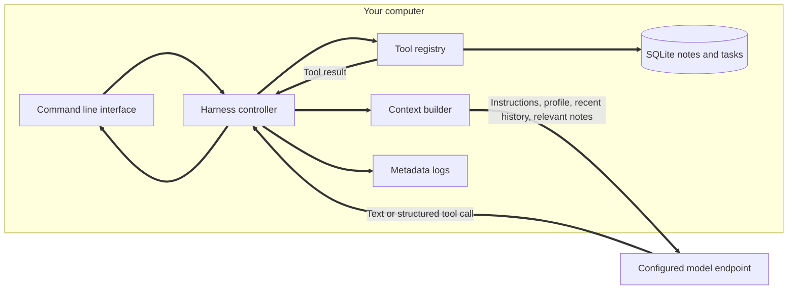
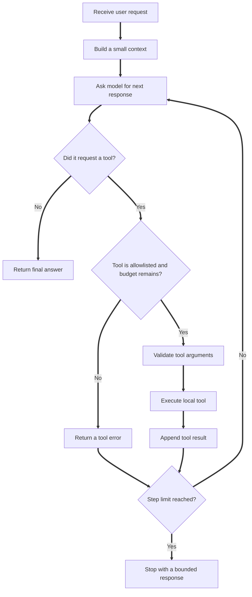
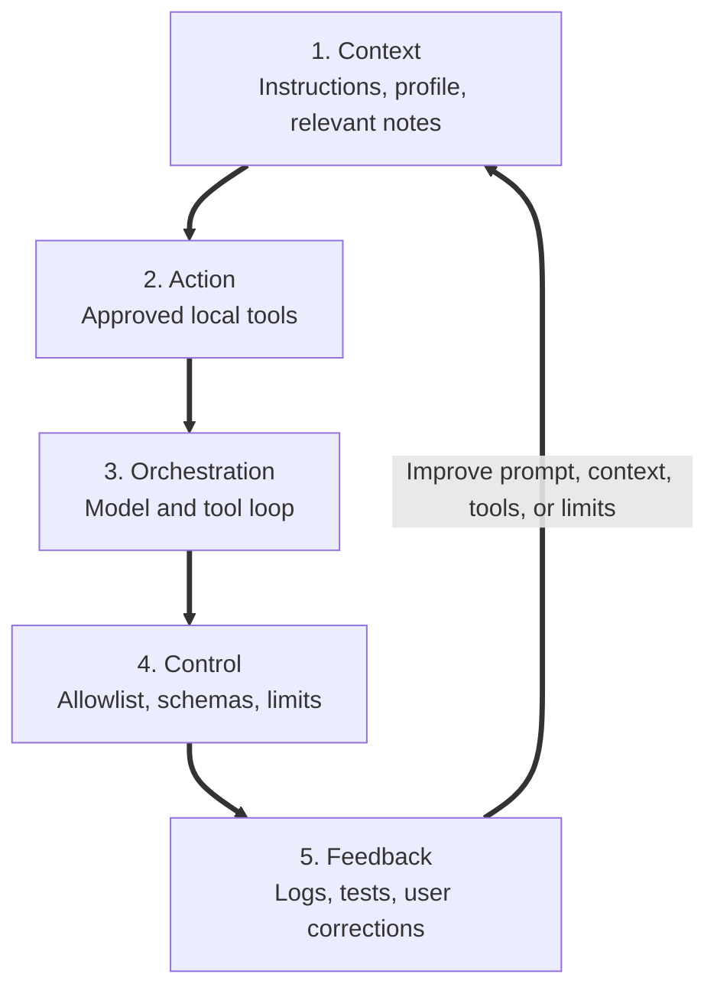
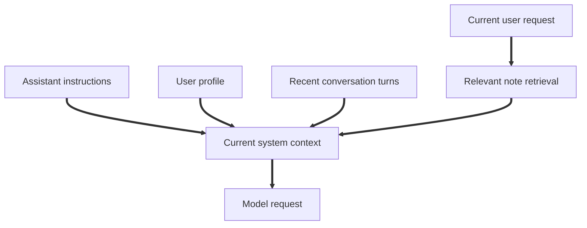
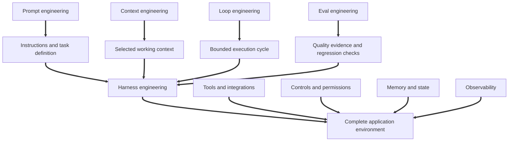

# Architecture and execution flow

## 1. Runtime architecture

The application runs locally. The model request is sent to the endpoint in `.env`. If that endpoint is hosted, the selected prompt, profile, relevant notes, conversation messages, and tool descriptions leave the computer as part of the request. Review the provider's data handling terms before using private information.

## 2. The bounded agent loop

The loop has two independent limits:

- `HARNESS_MAX_STEPS` limits model iterations.
- `HARNESS_MAX_TOOL_CALLS` limits the number of tool calls during a run.

Both are controls. A prompt that says "stop after a few steps" is not enough. The application enforces the limit.

## 3. How a request moves through the five pillars

This diagram is a conceptual view, not a literal execution sequence. Control is checked before tools execute, while feedback is gathered throughout the run.

## 4. Context assembly

The assistant does not load every note on every turn. It searches for a few notes with matching terms and includes those as potentially relevant context. This is a deliberately simple retrieval strategy for a small personal database. A larger knowledge base may need full-text search, embeddings, metadata filters, freshness rules, or a dedicated retrieval service.

## 5. Where the engineering disciplines fit

Prompt, context, loop, and eval engineering are distinct areas of practice. Harness engineering is the broader work of integrating them with tools, state, permissions, and runtime behaviour.
