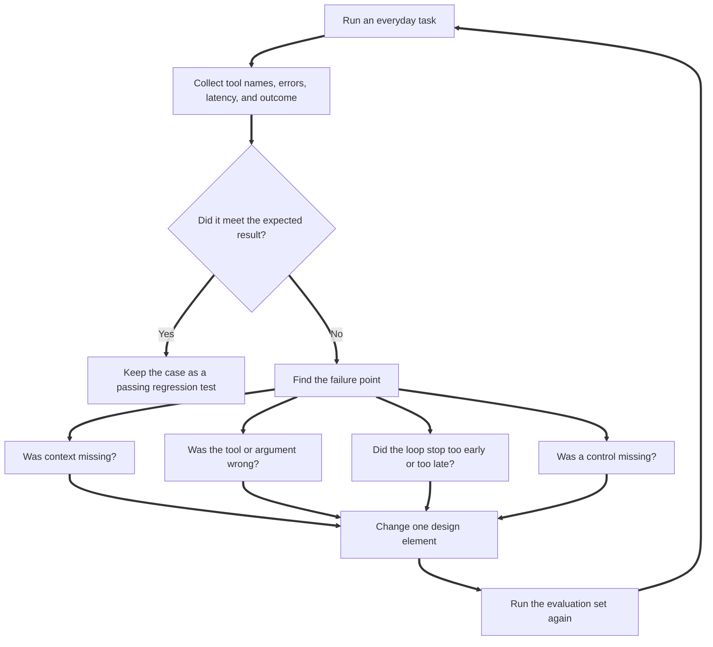

# Evaluation and feedback

A harness should be tested as a system, not judged only by a few good answers.

## 1. Two levels of evaluation

### Deterministic software tests

Run:

```bash
pytest
```

These tests verify behaviour that should not depend on a model:

- Notes can be saved and retrieved.
- Tasks can be added and listed.
- Invalid dates are rejected.
- Inputs over the configured limit are rejected.
- Unknown tools are blocked.

These are ordinary software tests. They should be reliable and run on every change.

### Model-backed behaviour tests

Run:

```bash
python evals/run_evals.py
```

This uses a temporary database and the configured model endpoint. It checks that the model selects the intended tool for five common requests. The temporary evaluation database is discarded when the script exits, so test data does not mix with personal notes.

Model-backed results can vary. A failure may indicate unclear tool descriptions, conflicting instructions, model limitations, or endpoint incompatibility.

## 2. Example evaluation matrix

| Scenario | Expected behaviour | Evidence |
|---|---|---|
| User asks to save a note | Call `save_note` once | Tool name and database record |
| User asks to find a saved note | Call `search_notes` | Tool result includes the stored note |
| User asks to add a task | Call `add_task` | New open task exists |
| User asks to mark a task complete | Call `update_task_status` | The selected task changes to done |
| User asks to list open tasks | Call `list_tasks` | Tool result contains the saved task |
| User asks a normal question | Answer without tools | Empty tool list |
| Model requests an unknown tool | Block the request | Tool executor returns an allowlist error |

## 3. What to measure as the harness grows

Track these measures over a representative test set:

- Task success rate: percentage of test cases meeting the expected outcome.
- Tool selection accuracy: whether the correct tool was called when required.
- Tool argument validity: percentage of calls with valid arguments.
- Unsupported action rate: attempts to use unregistered tools or actions outside scope.
- Recovery rate: whether the agent responds usefully after a tool error.
- Latency: end-to-end time and time spent in model calls and tools.
- Cost: model usage or provider billing where available.
- User correction rate: how often the user needs to fix the result.

A response can be fluent and still be wrong. Use outcome-based checks wherever possible.

## 4. Regression discipline

When changing a prompt, context rule, tool schema, or model endpoint:

1. Run deterministic tests.
2. Run the model-backed evaluation set.
3. Inspect failures and tool traces.
4. Add a test for every failure that matters.
5. Change one part of the harness at a time where possible.
6. Compare the new results with the previous baseline.

Do not let the agent silently rewrite its permanent instructions based on one correction. Convert repeated corrections into a proposed rule, review it yourself, update the configuration, and add a regression test.

## 5. Feedback loop


