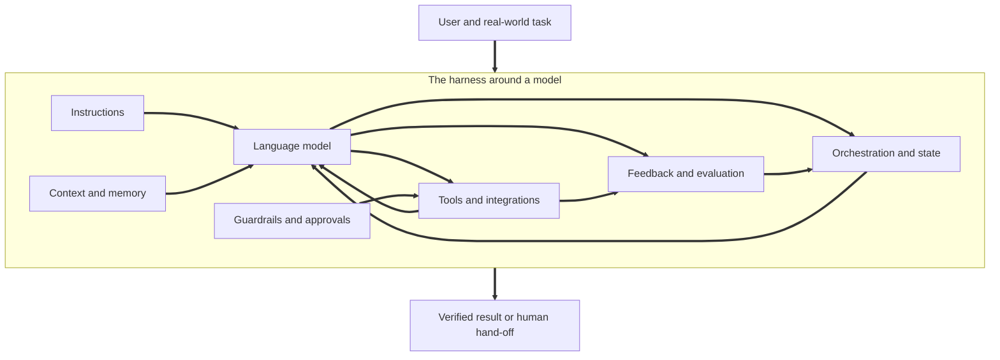
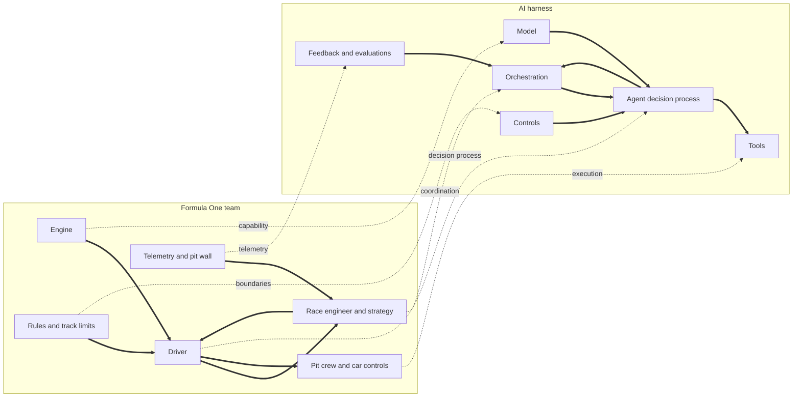
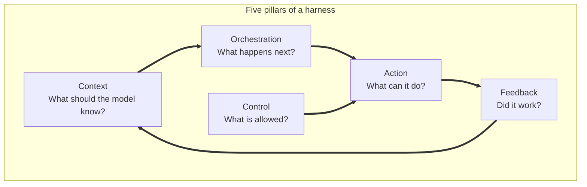
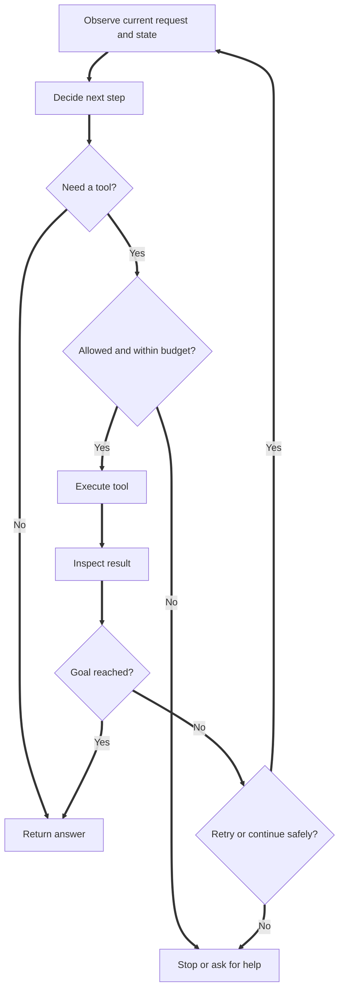
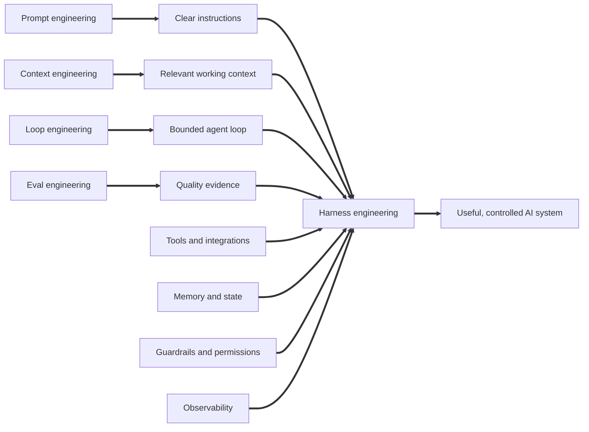
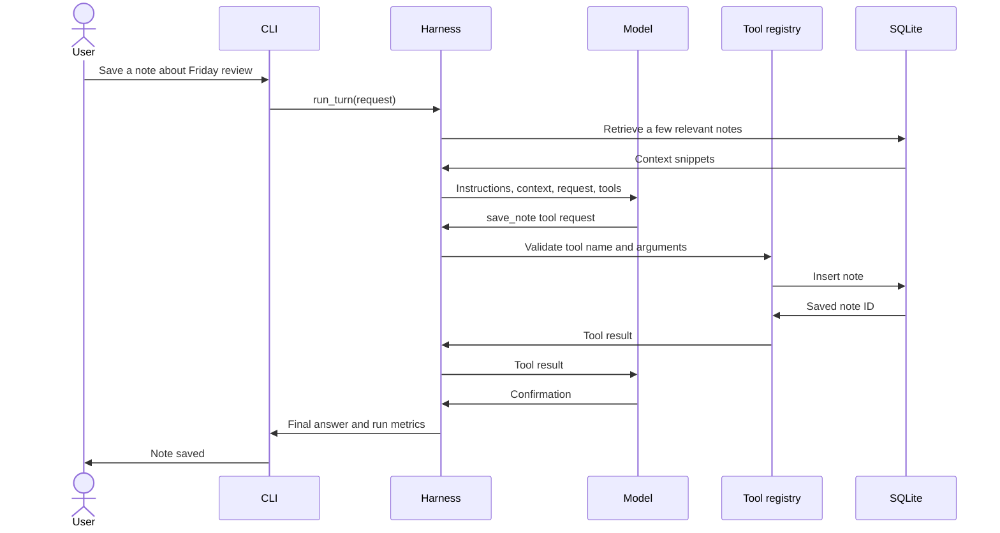

# Harness Engineering: Building the Working System Around an AI Model

## 1. The central idea

A language model can interpret a request, reason over information, and generate a response. That does not automatically make it a dependable assistant or a useful product.

A model does not automatically know which of your files is authoritative, whether a task has already been completed, which tools it is allowed to use, when it should ask for approval, how to recover from an API failure, or how to prove that a task was completed correctly. Those responsibilities belong to the system around the model.

**Harness engineering is the practice of designing, implementing, and improving that system around a model so that it can perform a defined job reliably, safely, and repeatedly.**

A practical harness brings together:

- Instructions that define the job and its boundaries.
- Context that gives the model the information needed for the current step.
- Tools that let it inspect or act on approved systems.
- Orchestration that coordinates multiple model and tool steps.
- State and memory that preserve useful information.
- Controls that restrict permissions and risky operations.
- Feedback and evaluations that reveal whether the system worked.
- A runtime that starts, monitors, and stops the workflow.

The model is a component inside this design. The harness is the operating environment in which that component is used.



A useful mental model is:

**Useful AI application = model capability + well-designed harness + real task knowledge.**

The model contributes language understanding and generation. The harness provides the process, capabilities, boundaries, and evidence. The task knowledge defines what a successful result actually means.

## 2. Model, agent, workflow, and harness are not the same thing

| Term | Meaning | Example |
|---|---|---|
| Model | The language model that receives input and generates output. | A model explains a technical concept. |
| Tool | A specific capability exposed to the model through an application. | Search saved notes or create a task. |
| Agent | A model-driven process that can pursue a goal through one or more steps, often using tools. | An assistant looks up a saved note and answers from it. |
| Workflow | A defined sequence of steps, some of which may use models and some of which may be ordinary code. | Read a document, extract fields, validate them, and produce a report. |
| Harness | The runtime and supporting system that manages context, tools, state, control, orchestration, and feedback for the model or agent. | The application that controls the assistant's complete execution. |
| Harness engineering | The work of designing, testing, securing, and improving that environment. | Building the tools, retrieval, loop, limits, tests, and monitoring. |

A simple chatbot may have a small harness: a prompt builder, a model API call, and a response handler. An agent that changes business records needs much more: permissions, validations, approval gates, durable state, retries, idempotency, logs, and evaluation.

An agent is not automatically better because it has many tools or can run for a long time. Use the simplest workflow that reliably completes the job.

## 3. Three analogies that explain harness engineering

The analogies below describe the same idea from three different angles. The horse explains how capability is connected to a job. The human body explains why intelligence needs supporting systems. Formula One explains how many specialised systems work together under rules and feedback.

### 3.1 The horse, the harness, and the cart

Imagine a strong horse standing beside a loaded cart. The horse has the strength to pull. But raw strength alone does not connect the animal to the cart, guide its movement, keep the equipment positioned, or help the driver manage the load.

A working driving setup has several parts:

1. **The horse:** supplies the physical power.
2. **The collar or breastcollar:** provides a surface through which the horse can transfer pulling force.
3. **The traces:** connect the horse's pulling effort to the vehicle.
4. **The bridle and reins:** give the driver a way to communicate direction and influence the horse's movement.
5. **The cart:** is the load or job to be performed.
6. **The driver:** decides where the cart should go and how the journey should be managed.

These parts should not be confused. The harness does not create the horse's strength. The bridle and reins are not the same thing as the traces. Each component has a defined role, and the whole arrangement makes the horse's strength useful for a particular job.

Now map that to an AI application:

| Horse and driving setup | AI system equivalent | Practical meaning |
|---|---|---|
| Horse | Language model | The source of language and reasoning capability. |
| Collar and traces | Tool and integration layer | Connects model decisions to approved capabilities. |
| Bridle and reins | Instructions, control logic, and permissions | Directs what the agent should do and constrains what it can do. |
| Cart | User's real task | The outcome the system must deliver. |
| Driver | Human operator and application policy | Defines the destination, authorises sensitive actions, and remains accountable. |
| Road conditions | Runtime context | The current data, constraints, and changing environment. |
| Inspection of equipment | Testing and monitoring | Detects defects before they cause repeated failures. |

Consider a simple example. A language model is asked to organise your day. It may be capable of creating a sensible plan, but without access to your calendar it cannot know when you are busy. Without a task list it cannot see your outstanding work. Without rules it might schedule tasks outside your working hours. Without a confirmation step it might create or move events that you did not approve.

The model supplies the capability. The harness connects it to the right information and actions while keeping the work within your rules.

The most important lesson from the horse analogy is this:

**A harness does not make the underlying capability stronger. It makes that capability usable, directed, and connected to a real job.**

#### A historical detail about horsepower

James Watt did not invent the first steam engine. Earlier designs, including the Newcomen engine, were already in use. Watt's separate condenser substantially improved steam-engine efficiency. Horsepower became a practical way to express engine output in terms buyers could compare with familiar horse work. It is useful historical context for the analogy, but it is not the definition of harness engineering. See the [Science Museum Group collection](https://collection.sciencemuseumgroup.org.uk/people/ap24508/watt-james) and [Historic Environment Scotland's biography of James Watt](https://www.historicenvironment.scot/about-us/our-work/commemorative-plaques/explore/james-watt/).

### 3.2 The human body: intelligence needs a complete operating system

Now think about your own body. Your brain is essential, but it cannot perform every physical function on its own. It depends on a network of systems that continuously collect information, coordinate movement, preserve knowledge, protect the body, and signal when something is wrong.

| Human body | What it does | Harness equivalent |
|---|---|---|
| Brain | Interprets information and makes decisions. | Language model. |
| Eyes and ears | Collect information from the environment. | Context sources, retrieval, and tool results. |
| Memory | Retains useful information from earlier experiences. | Conversation state, saved notes, and persistent application memory. |
| Hands and limbs | Interact with the physical world. | Tools, APIs, file operations, and other approved actions. |
| Nervous system | Carries signals and coordinates the body's activity. | Orchestration, agent loop, and task state. |
| Immune system and reflexes | Detect threats and help prevent or limit harm. | Permissions, validation, guardrails, and stop conditions. |
| Heart rate, temperature, and other vital signs | Indicate whether the body is functioning normally. | Logs, traces, latency, error rates, and evaluation metrics. |
| Sleep and recovery | Help restore and regulate the body. | Context cleanup, state compaction, session boundaries, and controlled restart. |

Imagine the brain receives a request to pick up a glass of water. The brain needs visual information about where the glass is. It needs the nervous system to coordinate muscles. It needs the hands to perform the action. It needs sensory feedback to adjust grip strength. Protective reflexes help prevent injury.

If one supporting system fails, the intention may be correct but the result can still be poor. A person may know what they want to do but lack the information, coordination, movement, or feedback needed to do it successfully.

The same applies to an AI agent:

- If context is missing, it makes decisions with incomplete information.
- If a tool is missing, it can describe an action but cannot perform it.
- If orchestration is missing, it may not know how to sequence multiple actions.
- If controls are missing, it may attempt an action outside the permitted scope.
- If feedback is missing, failures can remain invisible and repeat.

The body analogy is especially useful when debugging. Instead of saying only that the model gave a bad answer, ask which supporting system failed. Did it receive the wrong information? Did it fail to retrieve memory? Did the tool return an error? Did the loop stop too early? Did a validation rule fail to catch a bad result?

**Intelligence is one part of capability. Reliable behaviour emerges from the coordination of the whole system.**

### 3.3 Formula One: the engine is not the race-winning system

Formula One provides a system-level analogy. A powerful engine matters, but a racing result depends on much more than engine output.

A team also needs a chassis, aerodynamics, suspension, tyres, brakes, steering, a driver, engineers, pit crew, strategy, rules, telemetry, and a reliable process for responding to changing track conditions.

The driver does not independently manage every technical decision. The team monitors the car and race, communicates information, adjusts strategy, and works within sporting regulations. The pit wall is one visible example: senior team members monitor information and communicate with the driver. Formula One's [official glossary entry for the pit wall](https://www.formula1.com/en/latest/article/f1-glossary-p-t.GBhLQtpeu9b8LrK5VM0F1) describes this role.

| Formula One system | Harness equivalent | Why it matters |
|---|---|---|
| Engine | Model | Supplies the central performance capability. |
| Driver | Agent policy and model-driven decision process | Chooses actions in response to the task and available information. |
| Race briefing and track information | Context engineering | Explains the objective, current conditions, constraints, and strategy. |
| Steering, brakes, throttle, radio, and car controls | Tools and actions | Let the agent interact with its environment. |
| Race engineer and team strategy | Orchestration | Coordinates decisions and the sequence of actions. |
| Sporting regulations and track limits | Control and permissions | Define what is allowed and what must not happen. |
| Pit crew | Tool execution layer | Performs specialised actions in a defined sequence. |
| Pit wall and telemetry | Feedback and evaluation | Reveals current performance, problems, and changing conditions. |
| Setup notes and lessons from previous races | Memory | Preserves useful knowledge between runs. |
| Race start procedure and prepared strategy | Automation | Starts an established workflow when the trigger occurs. |

A practical AI example is a daily research assistant. The model is the engine. It needs a briefing that explains the research question and what sources are acceptable. It needs tools to retrieve documents. It needs an execution loop to gather evidence, compare it, and prepare a report. It needs rules against fabricating citations. It needs a verification step to check that sources support the claims. It needs logs so you can see which sources were used and where the workflow failed.

A bigger engine will not automatically fix weak retrieval, incorrect tool permissions, poor task sequencing, or missing verification. Likewise, a better model will not repair a badly designed workflow by itself.

#### One complete Formula One to AI map



The analogy is not a literal component-by-component engineering specification. It is a way to remember the important principle: performance comes from the coordinated system, not from one powerful component alone.

## 4. The five pillars of a harness

The five pillars in this guide are **Context, Action, Orchestration, Control, and Feedback**. This is a practical architecture for thinking about harnesses. It is not a claim that every organisation uses one universally standardised five-pillar taxonomy.

### Pillar 1: Context

**Context engineering decides what information the model should receive for the current step, when it should receive it, and how that information should be organised.**

Context can include:

- System and task instructions.
- User request and recent conversation.
- User profile and preferences.
- Documents and knowledge retrieved for the task.
- Database records and API responses.
- Tool definitions and usage instructions.
- Current workflow state and previous tool results.
- Examples, reference schemas, and evaluation criteria.

More context is not always better. A large collection of irrelevant, duplicated, stale, or contradictory information may make the important details harder to identify. Anthropic describes context engineering as curating the information available to the model at inference time and recommends keeping the context informative but focused. Read [Effective context engineering for AI agents](https://www.anthropic.com/research/effective-context-engineering-for-ai-agents).

**Everyday example:** A daily planning assistant should receive today's date, the relevant calendar events, open tasks, and your working-hour preferences. It does not need every note you have ever saved.

**Questions for the engineer:**

- What must the model know to complete this step?
- Which source is authoritative?
- Is this information current?
- What can be retrieved just in time instead of loaded up front?
- Which data should never enter the model context?

### Pillar 2: Action

The action pillar gives the model approved capabilities through tools. A model can recommend that a task be added, but an application tool is what actually writes the task to a database.

Common actions include:

- Read-only search over documents or databases.
- APIs for business applications.
- Browser or search tools.
- File reading and writing within a restricted area.
- Code execution inside a sandbox.
- Calendar, email, ticketing, or task-management integrations.
- MCP servers that expose tools or resources through a standard protocol.

Each tool should have a narrow purpose, clear name, input schema, output schema, permission level, timeout, and defined failure behaviour. Tool descriptions should be specific enough that the model can distinguish between similar capabilities. The [Model Context Protocol tools specification](https://modelcontextprotocol.io/specification/2025-11-25/server/tools) describes how servers expose callable tools with metadata and schemas.

**Everyday example:** The personal assistant in this repository can save a note, search notes, add a task, and list tasks. It cannot send an email or delete a file.

**Questions for the engineer:**

- What action is actually needed?
- Can the tool be read-only?
- What is the narrowest useful permission?
- Can the action be repeated safely?
- What happens when the tool times out or returns invalid data?

### Pillar 3: Orchestration

Orchestration coordinates the sequence of model and tool operations. It manages the workflow from the user's request to a final result or a human hand-off.

Orchestration can involve:

- Planning and task decomposition.
- Selecting the next tool or subtask.
- Managing a shared workflow state.
- Passing information between steps.
- Calling a tool and feeding its result back to the model.
- Retrying transient failures within a limit.
- Checkpointing progress.
- Handing work to a specialist or human reviewer.
- Deciding when the task is complete.

**Everyday example:** For the request "Find my note about my weekly review", the assistant should search its note store, inspect the returned result, and answer from that result. It should not invent a memory or repeatedly call the tool after a useful result has been found.

**Questions for the engineer:**

- What is the next step?
- What information must move between steps?
- What should happen after a tool error?
- How many steps and retries are allowed?
- When should the system stop or ask a person?

### Pillar 4: Control

Control defines and enforces the boundaries of the system. It includes both instructions and application-level enforcement. For important restrictions, the application must enforce the rule rather than relying only on the model to obey a prompt.

Control mechanisms include:

- Authentication and identity.
- Role-based access control and least privilege.
- Tool allowlists.
- Input and output validation.
- Sandboxed execution.
- Approval gates for sensitive actions.
- Rate, cost, time, and step limits.
- Data retention and privacy rules.
- Idempotency and duplicate-action protection.
- Safe stop and escalation behaviour.

**Everyday example:** The starter project allows adding tasks but does not provide a delete operation. The model cannot call arbitrary Python functions because the tool executor accepts only a small, explicit allowlist.

**Questions for the engineer:**

- What is forbidden?
- Which actions require explicit approval?
- Where is permission checked in code?
- Can a failure create duplicate or harmful side effects?
- Can the system stop safely?

### Pillar 5: Feedback

Feedback makes system behaviour observable and measurable. It provides evidence about whether a workflow completed successfully and where it failed.

Useful feedback includes:

- Logs and traces of model and tool steps.
- Tool success and error rates.
- Output validation results.
- Quality evaluations against expected outcomes.
- Latency and token usage.
- Cost and rate-limit events.
- User corrections and approvals.
- Task completion and downstream business outcomes.

**Everyday example:** If the assistant repeatedly fails to find notes, logs can show whether it called `search_notes`, while tests can show whether the database search itself works. This separates a model tool-selection problem from a storage or retrieval bug.

**Questions for the engineer:**

- Did the task finish?
- Was the result correct?
- Did the tool return what was expected?
- Where did the workflow fail?
- Can we reproduce the failure in a test?
- Did our latest change improve results without breaking previous behaviour?

### The five pillars at a glance

| Pillar | Main responsibility | Body analogy | Formula One analogy |
|---|---|---|---|
| Context | Provide relevant information | Eyes, ears, and memory | Race briefing and track information |
| Action | Perform approved operations | Hands and limbs | Car controls and pit crew |
| Orchestration | Coordinate steps and state | Nervous system | Driver, race engineer, and team strategy |
| Control | Enforce boundaries and safety | Immune system and reflexes | Sporting regulations and track limits |
| Feedback | Measure results and detect problems | Vital signs and sensory feedback | Telemetry and pit wall |



In a real application these pillars overlap. For example, context is rebuilt after each tool call, controls are checked before tool execution, and feedback is collected throughout the run.

## 5. Five engineering disciplines and their relationship to the pillars

The following five disciplines are useful ways to divide the work. They operate at different levels and should not be confused with the five architectural pillars.

| Discipline | Focus | Key question | Main relationship to the pillars |
|---|---|---|---|
| Prompt engineering | Writing clear task and behaviour instructions | What should the model do, and what should the answer look like? | Primarily Context and Control. |
| Context engineering | Selecting and updating the information available to the model | What does the model need to know now? | Context, with support from Orchestration. |
| Loop engineering | Designing the repeated model, action, observation, and stop cycle | How does the agent make progress safely? | Primarily Orchestration, supported by Control and Feedback. |
| Eval engineering | Defining test cases, rubrics, graders, and regression checks | How will we know whether it worked? | Primarily Feedback, with Control through release gates. |
| Harness engineering | Integrating the model, tools, context, state, permissions, and feedback | What complete environment makes this system useful and dependable? | All five pillars. |

The label **loop engineering** is used here as a practical description of engineering an agent's execution loop. Unlike prompt engineering or evaluation, it is not a universally fixed industry standard with one agreed definition. The same is true of some emerging uses of harness engineering. Treat these as useful engineering concepts, not as a rigid certification taxonomy.

### 5.1 Prompt engineering

Prompt engineering is the design and improvement of the instructions given to a model. A good prompt clarifies the role, objective, relevant constraints, expected output, and how to handle missing information.

Weak prompt:

```text
Summarise my meeting.
```

Better prompt:

```text
Summarise the supplied meeting notes for a teammate who did not attend.

Return these sections:
1. Decisions made
2. Action items with owner and due date
3. Open questions
4. Risks and blockers

Do not invent missing owners or dates. Write "Not specified" when the notes do not contain the information. Keep the summary under 250 words.
```

The second prompt makes the task and expected response more precise. It still does not provide access to the meeting notes or create tasks in a project tracker. Those capabilities belong to the wider harness.

### 5.2 Context engineering

Context engineering concerns the complete working information made available to the model at each step. It includes the prompt, profile, retrieved files, tool descriptions, previous messages, memory, and tool results.

A good strategy is to retrieve information when it becomes relevant, rather than placing every available document into every model request. Context should be accurate, current, appropriately scoped, and clearly separated from instructions.

Example: a project assistant should retrieve the relevant project decision record when asked about an architectural choice. It should not rely on an old conversation if a newer approved decision document exists.

### 5.3 Loop engineering

Loop engineering designs the repeated execution cycle that lets an agent make progress across several steps. A common pattern is:

**Observe → Decide → Act → Inspect → Continue or Stop.**

For example:

1. Observe the user's request and current task state.
2. Decide whether information or an action is needed.
3. Call an approved tool.
4. Inspect the tool result.
5. Decide whether another step is needed.
6. Return the answer, request clarification, or hand off for approval.

A robust loop needs:

- A maximum number of model steps.
- A maximum number of tool calls.
- Tool timeouts.
- Retry rules for transient failures.
- Error handling for invalid arguments.
- A completion condition.
- A stop condition when the task cannot proceed safely.

Without these rules, an agent can repeat the same action, consume unnecessary resources, or continue after it should have stopped.



### 5.4 Eval engineering

Eval engineering turns expectations into repeatable tests. A system should be tested on representative cases, not only on examples chosen because they produce impressive answers.

An evaluation set can include:

- Typical successful cases.
- Missing or ambiguous information.
- Invalid tool arguments.
- Tool timeouts and failures.
- Boundary and permission cases.
- Adversarial or misleading input.
- Repeated requests and duplicate-action scenarios.
- Cases where the correct behaviour is to ask a human.

For a task-management assistant, an evaluation might check that an explicit request to add a task results in one tool call and one database record. It should also check that a normal question does not create a task accidentally.

Use a combination of deterministic assertions, structured output validation, human review, and model-based graders where appropriate. An LLM judge can help assess open-ended quality, but it can also make mistakes. Keep objective checks for facts that can be verified directly.

OpenAI's [guide to working with evals](https://developers.openai.com/api/docs/guides/evals) describes evaluations as a way to test model outputs against specified criteria and iterate on system behaviour.

### 5.5 Harness engineering

Harness engineering is the broader system-design discipline. It integrates all the pieces into a runtime that can complete the task in the real environment.

The harness decides:

- Which prompt and context are assembled.
- Which tools are available to the model.
- How tool requests are validated and executed.
- How the next model step is scheduled.
- How memory and state persist.
- Which actions need approval.
- How failures, metrics, and quality are recorded.
- When the run is complete or must stop.

OpenAI's article [Harness engineering: leveraging Codex in an agent-first world](https://openai.com/index/harness-engineering/) describes an engineering approach that makes repository knowledge, tools, architecture rules, and feedback legible to agents. The central practical lesson is that the environment must make the right information and constraints discoverable to the agent.

### How the disciplines combine



## 6. Configure a simple harness for everyday use

The best way to understand harness engineering is to build a small working assistant and operate it for real tasks. The companion repository in this project is called **Everyday AI Harness**.

It is intentionally modest. It runs from a command line, stores personal notes and tasks in SQLite, and connects to a configurable OpenAI-compatible model endpoint.

### What it does

- Answers general questions.
- Saves a note when you explicitly ask it to remember something.
- Searches your saved notes when you ask about previous information.
- Adds a task when you explicitly ask.
- Lists your open or completed tasks.
- Marks a task done or reopens it only after you explicitly request the change.
- Loads your preferences from a Markdown profile.
- Retrieves a few potentially relevant notes rather than placing the entire note database in context.
- Limits the number of steps and tool calls.
- Records timing and tool metadata without writing private message content into logs.

### What it deliberately does not do

- Execute arbitrary shell commands.
- Browse websites.
- Send emails or messages.
- Delete files.
- Make purchases.
- Change external business records.

These restrictions keep the first version understandable and safer. Add integrations only after the basic workflow is useful and tested.

### Repository structure

```text
everyday-ai-harness/
├── config/
│   ├── assistant.md
│   └── profile.md
├── docs/
│   ├── architecture.md
│   ├── daily-usage.md
│   ├── evaluation.md
│   └── harness-engineering.md
├── evals/
│   ├── cases.json
│   └── run_evals.py
├── src/everyday_harness/
│   ├── __init__.py
│   ├── __main__.py
│   ├── config.py
│   ├── harness.py
│   ├── llm.py
│   ├── observability.py
│   ├── store.py
│   └── tools.py
├── tests/
│   ├── test_tools.py
│   └── test_harness.py
├── .env.example
├── .github/
│   └── workflows/
│       └── tests.yml
├── .gitignore
├── LICENSE
└── pyproject.toml
```

### Step 1: Configure the connection

The `.env` file contains the model endpoint, API key, model name, local data paths, and runtime limits.

```dotenv
LLM_BASE_URL=http://localhost:11434/v1
LLM_API_KEY=local
LLM_MODEL=YOUR_MODEL_NAME

HARNESS_DATABASE=data/harness.sqlite3
HARNESS_LOG_FILE=logs/runs.jsonl
HARNESS_MAX_STEPS=6
HARNESS_MAX_TOOL_CALLS=8
HARNESS_HISTORY_TURNS=5
HARNESS_REQUEST_TIMEOUT=60
```

The endpoint is a configurable example. Use a local or hosted endpoint that supports the chat completions and tool-calling format expected by the application. Keep real credentials in `.env`, never in the repository.

### Step 2: Install and run

Windows PowerShell:

```powershell
py -3.11 -m venv .venv
.\.venv\Scripts\Activate.ps1
python -m pip install -e ".[dev]"
Copy-Item .env.example .env
python -m everyday_harness
```

macOS or Linux:

```bash
python3 -m venv .venv
source .venv/bin/activate
python -m pip install -e ".[dev]"
cp .env.example .env
python -m everyday_harness
```

### Step 3: Personalise the assistant

Edit `config/assistant.md` to change stable behaviour and tool-use rules. Edit `config/profile.md` to add preferences that are useful across repeated conversations.

For example:

```markdown
# Personal profile

## Communication
- Explain technical topics in plain English.
- Prefer examples that resemble real software projects.
- Keep routine answers focused.

## Working preferences
- Separate facts from assumptions.
- Do not invent dates, owners, or decisions.
- Ask before an external action.
```

Do not put secrets in these files. A profile should contain stable preferences, not every detail about every task.

### Step 4: Try everyday requests

```text
Remember that I prefer short, structured meeting notes.
```

This should call `save_note` and write the note to SQLite.

```text
Find the note about my preferred meeting notes.
```

This should call `search_notes` and answer from the stored result.

```text
Add a task titled Review the architecture notes.
```

This should call `add_task`.

```text
Show my open tasks.
```

This should call `list_tasks`.

```text
Mark task 1 as done.
```

This should call `update_task_status` only because you explicitly requested a status change. To change the status, say `Mark task 1 as done` or `Reopen task 1`. The status tool runs only after an explicit request.

The database remains local between runs. The conversation history in the first version is short-lived and held in the current CLI session. The note and task records persist in SQLite.

### Step 5: Understand the code path

The main request flow is:

1. `__main__.py` receives a message.
2. `harness.py` loads instructions and profile data.
3. It adds the computer-reported local date and time and retrieves up to three potentially relevant saved notes.
4. `llm.py` sends the message, context, and tool schemas to the configured endpoint.
5. If the model requests a tool, `ToolRegistry` checks that the requested name is allowed.
6. `tools.py` validates the arguments and executes the selected local function.
7. The tool result is returned to the model for the next step.
8. The harness stops when the model returns a normal response or a configured limit is reached.
9. `observability.py` records metadata such as latency, step count, and tool names.



### Step 6: Test before extending

Run deterministic tests:

```bash
pytest
```

Then, when the configured endpoint is running, execute the model-backed evaluations:

```bash
python evals/run_evals.py
```

The deterministic tests validate the tool contracts and storage. The model-backed tests check whether the model chooses the expected tool for common requests. They are different kinds of checks and both are useful.

## 7. How to configure it for a real daily routine

A practical routine can be simple:

### Morning

Ask the assistant to list open tasks. Add new tasks that you want to track. Ask it to help prioritise the list, but review the priorities yourself.

### During work

Ask it to save useful decisions or information when you explicitly want those details to be searchable later. Use the note search when you need to recall something.

### End of day

Ask for the open task list. Compare it with what you completed. In this starter, tasks are not automatically marked complete. Keeping that action manual avoids accidental changes to task state.

### Weekly maintenance

Review `config/profile.md` and remove preferences that are no longer useful. Inspect saved notes and delete or archive outdated information using a database maintenance utility you trust. Review logs for unusual tool-call counts, latency spikes, and repeated failures.

The habit matters more than the sophistication of the framework. Start with a workflow you will actually use, then improve it when you observe a real limitation.

## 8. Memory is not model training

A common source of confusion is the word memory. In this starter project, memory means application data that persists outside the model context.

- The profile is a human-edited Markdown file.
- Notes are records stored in SQLite.
- A retrieval function selects a few relevant notes for the current request.
- The model sees the selected note text as context.

The model's parameters are not being updated. The assistant is not training itself. It is reading and writing data through application code.

For a personal collection, keyword retrieval may be sufficient. For larger collections, consider full-text indexing, semantic embeddings, metadata filters, source freshness, and access-control filters. A retrieval system should also preserve provenance so that the assistant can distinguish a saved note from an authoritative document.

## 9. How to extend the harness without making it fragile

Add capabilities in small stages:

1. Keep the initial tool set small and learn how it behaves.
2. Add one new tool with a narrow purpose.
3. Add input validation and a permission check in application code.
4. Add unit tests for valid and invalid inputs.
5. Add model evaluation cases for correct tool selection.
6. Log tool names, timing, and errors without logging private text by default.
7. Start with read-only integrations.
8. Add write access only when needed, with human approval for sensitive operations.
9. Add automation only after manual execution is reliable.

For example, a calendar integration should begin with read-only access to today's events. Only later should it be allowed to create a draft event. Sending invitations or moving existing events should require a separate permission and explicit confirmation.

Do not give an agent an unrestricted shell or broad file-system access just because it makes a demo easier. Define the exact task, tool, permission, and stop condition first.

## 10. Common mistakes when building a harness

| Mistake | Why it causes problems | Better approach |
|---|---|---|
| Treating the model as the whole application | Missing information, tools, and controls remain unsolved. | Design the complete task environment. |
| Putting every document into context | Relevant information becomes harder to identify. | Retrieve the smallest useful set. |
| Providing too many overlapping tools | Tool selection becomes ambiguous and permissions expand. | Use a small set of clearly differentiated tools. |
| Giving tools broad permissions | A mistaken action can have a large impact. | Apply least privilege and explicit allowlists. |
| Running an unlimited agent loop | Repeated calls waste time and money. | Enforce step, tool, time, and cost budgets. |
| Letting the model decide whether its own work is correct | Self-review may miss the same error. | Use deterministic checks or an independent reviewer where needed. |
| Treating every user correction as permanent memory | One-off corrections can distort future behaviour. | Review proposed rule changes and add regression tests. |
| Testing only happy paths | Edge cases and tool failures remain invisible. | Include missing data, invalid input, errors, and forbidden actions. |
| Logging full prompts by default | Sensitive information may be copied into logs. | Log operational metadata and protect any content traces. |

## 11. A practical checklist for any harness

Before calling a harness ready for regular use, check the following:

- [ ] The job and success criteria are clearly defined.
- [ ] The model receives relevant, current context.
- [ ] Tool descriptions and schemas are explicit.
- [ ] Only approved tools are executable.
- [ ] Tool arguments are validated in application code.
- [ ] External and irreversible actions require approval.
- [ ] The agent loop has bounded steps and tool calls.
- [ ] Failures have defined recovery or stop behaviour.
- [ ] Persistent state has a clear owner and retention policy.
- [ ] Logs and traces make failures diagnosable.
- [ ] Representative evaluations are repeatable.
- [ ] Secrets and personal data are not committed to source control.
- [ ] A human remains responsible for decisions that require judgement or authority.

## 12. The final takeaway

The horse analogy reminds us that capability must be connected to a job. The human body analogy reminds us that intelligence relies on information, movement, coordination, protection, and feedback. Formula One reminds us that winning performance comes from an integrated team and a well-engineered system, not simply a powerful engine.

Harness engineering brings those lessons into AI development. It is the work of building the environment in which a model can do useful work consistently. That environment includes the right context, the right actions, a disciplined execution loop, enforceable controls, persistent state, and measurable feedback.

You do not need to start with a multi-agent platform or a large infrastructure stack. Start with one real everyday task. Give the model the information it needs. Add one or two safe tools. Put a limit on the loop. Test what happens when something goes wrong. Observe the result. Improve the weakest part.

**The model provides capability. The harness turns that capability into a dependable way of working.**

## References and further reading

1. OpenAI, [Harness engineering: leveraging Codex in an agent-first world](https://openai.com/index/harness-engineering/).
2. OpenAI, [Agents SDK](https://developers.openai.com/api/docs/guides/agents/sdk).
3. OpenAI, [Prompt engineering](https://developers.openai.com/api/docs/guides/prompt-engineering).
4. OpenAI, [Working with evals](https://developers.openai.com/api/docs/guides/evals).
5. Anthropic, [Effective context engineering for AI agents](https://www.anthropic.com/research/effective-context-engineering-for-ai-agents).
6. Anthropic, [Effective harnesses for long-running agents](https://www.anthropic.com/research/effective-harnesses-for-long-running-agents).
7. Model Context Protocol, [Tools specification](https://modelcontextprotocol.io/specification/2025-11-25/server/tools).
8. Formula One, [F1 glossary: Pit wall](https://www.formula1.com/en/latest/article/f1-glossary-p-t.GBhLQtpeu9b8LrK5VM0F1).
9. Science Museum Group, [James Watt](https://collection.sciencemuseumgroup.org.uk/people/ap24508/watt-james).
10. Historic Environment Scotland, [James Watt](https://www.historicenvironment.scot/about-us/our-work/commemorative-plaques/explore/james-watt/).
